<p align="center">
  <a href="https://github.com/Alsanad-Opium"></a>
  
  
</p>

<p align="center">
  <a href="https://git.io/typing-svg"></a>
</p>



## 👾 `whoami`

```python
class Alsanad:
    name      = "Mohammad Alsanad Sheikh"
    alias     = "Alsanad-Opium"
    education = "Diploma in AI & ML · Government Polytechnic Nagpur"
    role      = ["Full Stack Developer", "ML Deployment Enthusiast"]
    mission   = "Build real-world AI + Web products"
    stack     = {
        "languages": ["Python", "C", "C++", "Java", "JavaScript", "HTML", "CSS"],
        "frontend":  ["React", "Next.js", "Tailwind", "shadcn/ui", "WordPress"],
        "backend":   ["Flask", "Java Servlets", "JDBC", "Apache", "Tomcat"],
        "databases": ["MySQL", "PostgreSQL", "MongoDB", "Oracle"],
    }

    def currently(self):
        return "shipping ML models behind clean UIs ⚡"
```


## ⚙️ Tech Stack

<div align="center">

**🧑‍💻 Languages**


**🌐 Frontend & UI**


`shadcn/ui`

**🧠 Backend & Frameworks**


`Servlet` · `JDBC` · `Swing`

**🗄️ Databases**


**🛠️ Tools**


</div>


## 📊 GitHub Activity

<div align="center">


</div>


## 🧩 Contribution Graph

<picture>
  <source media="(prefers-color-scheme: dark)" srcset="https://raw.githubusercontent.com/Alsanad-Opium/Alsanad-Opium/output/pacman-contribution-graph-dark.svg">
  <source media="(prefers-color-scheme: light)" srcset="https://raw.githubusercontent.com/Alsanad-Opium/Alsanad-Opium/output/pacman-contribution-graph.svg">
  
</picture>

<div align="center">
  
</div>


## 📬 Connect With Me

<div align="center">
  <a href="https://www.linkedin.com/in/mohammad-alsanad-sheikh-a12818302"></a>
  <a href="mailto:alsanad112006@gmail.com"></a>
  <a href="https://discordapp.com/users/Opium_gng"></a>
</div>

